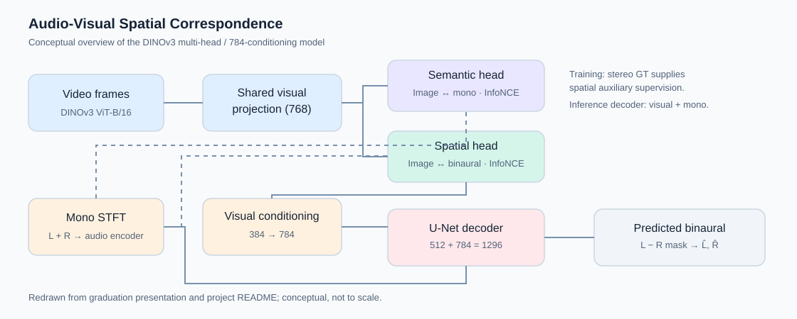
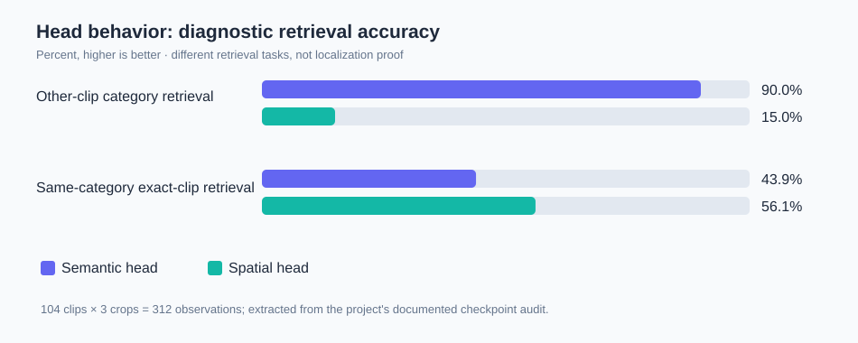

# Audio-Visual Spatial Correspondence Learning
**Binaural Audio Generation via Multi-Head Aggregation** · Undergraduate graduation research project

> **Research question:** Can audio–visual contrastive objectives for **what is sounding** (semantic) and **where it is sounding** (spatial) help reconstruct binaural audio from a mono recording and corresponding video?

This page is a concise public research showcase, adapted from our final graduation presentation (30 October 2026) and the project's research README. It is not a source-code release.

## Method at a glance

A frozen **DINOv3 ViT-B/16** extracts video patch features. A trainable shared visual projection branches into semantic and spatial correspondence heads. Mono audio supplies semantic features; **ground-truth stereo audio is used as auxiliary supervision for the spatial head during training**. A visually conditioned U-Net predicts a complex difference spectrogram; the generated left/right channels are reconstructed from the mono sum and predicted difference. Crucially, the generation decoder does **not** take the ground-truth stereo features as input.

- **Semantic head:** video ↔ mono audio; learns correspondence related to sounding objects or instrument categories.
- **Spatial head:** video ↔ binaural cues (including interaural phase and channel magnitudes); investigates directional/instance correspondence.
- **Reconstruction:** a spatial visual feature is pooled and projected to **784** conditioning channels, combined with the **512**-channel mono bottleneck in the decoder.
- **Training objective:** difference-spectrogram MSE + semantic InfoNCE + spatial InfoNCE.

## Reconstruction ablation

**Same recorded 104-clip seen-category evaluation** (normalization enabled; one shared seed; lower is better):

| Configuration | STFT ↓ | Envelope ↓ |
| --- | ---: | ---: |
| **Multi-head · product → pool** | **0.817257** | **0.128432** |
| Multi-head · pool → product | 0.830878 | 0.129352 |
| Mono-only single-head · pool → product | 0.831159 | 0.129419 |
| Mono-only single-head · product → pool | 0.832363 | 0.130012 |

**Interpretation:** The tested multi-head/product-then-pool configuration achieved the lowest recorded reconstruction errors in this comparison. However, the single/multi comparisons also change auxiliary supervision and decoder feature routing, so the improvement **cannot be attributed to head count alone**.

**Split correction:** The historical file named `unseen1` actually corresponds to a **seen-category** split (832 train / 104 validation / 104 test clips). The 0.817257 value is *not* evidence of unseen-category generalization.

## What did the two heads learn?

On a frozen-checkpoint diagnostic involving **104 clips × 3 audio crops**, the semantic head was better at other-clip instrument-category retrieval (**90.0%** versus **15.0%**), while the spatial head was better at identifying the exact clip within the same category (**56.1%** versus **43.9%**). These are retrieval diagnostics, not direct measures of spatial localization.

Additional image-flip / L–R-swap interventions showed a directional preference in some settings: the spatial head favored original binaural audio for **94.9%** of original-image crops, and swapped audio for **65.7%** of flipped-image crops. There are meaningful failure cases; this does **not** establish full semantic/spatial disentanglement.

## Video demo

The final graduation presentation includes a **QR code** linking to a Google Drive folder of demonstration materials:

**[Open the audio-visual binaural-generation demos](https://drive.google.com/drive/folders/1CDPN2AykF32mWWVIRzhfJ1IwfTWcGGyq)**

The link is taken directly from the QR code embedded in the final presentation. The presentation also contains playable video media, but those files have **not** been uploaded to this public portfolio. Please use headphones when listening to stereo/binaural examples.

> **Access note:** Google Drive viewing permissions have not been verified for anonymous visitors. Before sharing this page with a prospective supervisor, set the demo folder and its relevant files to **Anyone with the link → Viewer**, if you have permission to make them public. A QR code does not bypass Drive permissions.

## Generalization and limitations

A follow-up *true category-unseen* evaluation (Category A training, Category B held out) identified a persistent B-category gap. On the same 29 B-category test clips, the seen-training model recorded **0.7041 STFT**, versus **0.8502 STFT** for the A-only training model. Training-set sizes and update counts also differed, so this is an exploratory comparison rather than a strictly controlled causal test.

**Takeaway:** The project demonstrates a structured research cycle—model design, ablation, diagnostic probing, and evaluation correction—while leaving open questions about robust category generalization and the causal roles of each learned representation.

## Research provenance

- Collaborative graduation project by **Hyunwoo Chung and Jungwon Lee**; contributions should be described at the project level unless individually verified.
- Methodological foundations include [2.5D Visual Sound / FAIR-Play](https://github.com/facebookresearch/2.5D-Visual-Sound), [DenseAV](https://github.com/mhamilton723/DenseAV), [DINOv3](https://github.com/facebookresearch/dinov3), and [CCStereo](https://github.com/SonyResearch/CCStereo).
- The model diagram and summary chart above are **new schematic visualizations** of the presentation and README evidence, not exported slide screenshots. The full slide deck and private implementation are not published here. Dataset recordings and pretrained weights are not redistributed.
