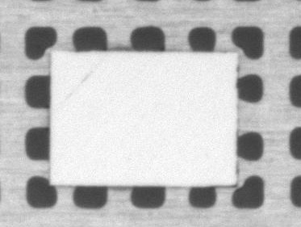
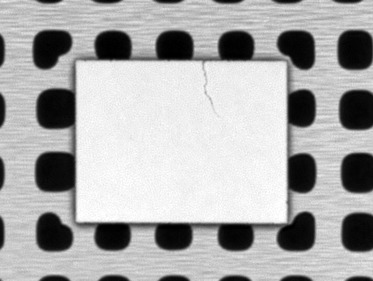
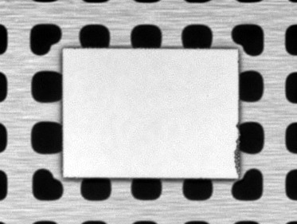
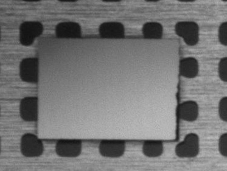
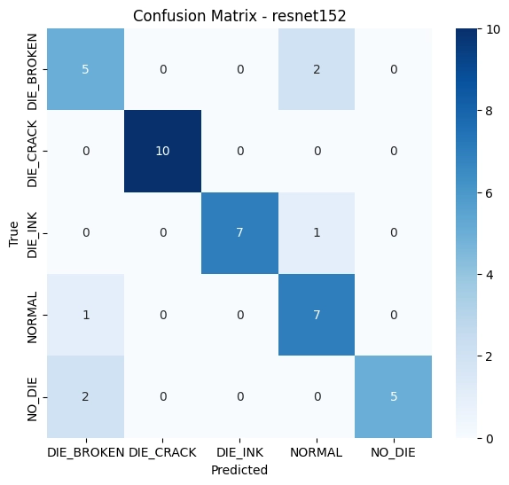
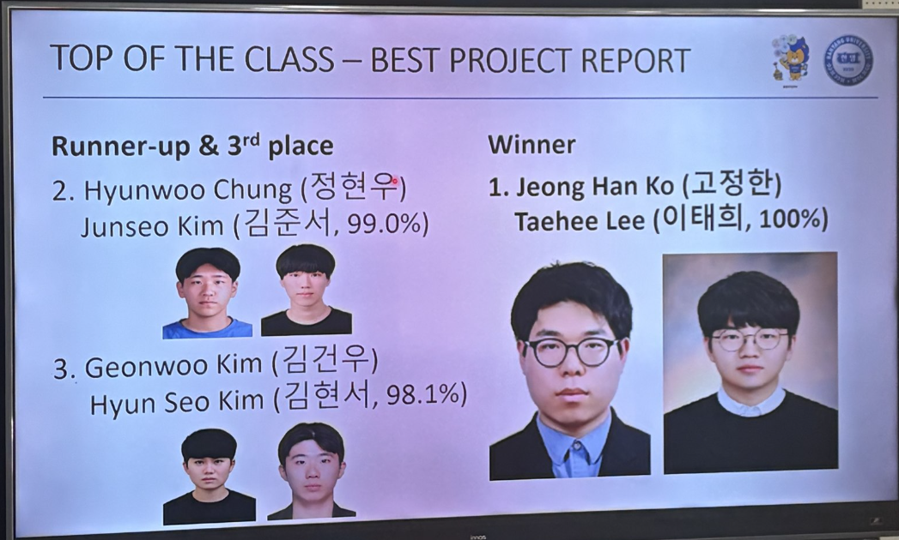

# Wafer Defect Classification

*Improving Wafer Defect Classification under Limited G4 Data using G5 Transfer Learning and Data Augmentation*  
Course project by Junseo Kim and Hyunwoo Chung

## Task and data

We classified wafer-die images into five categories: **DIE_BROKEN, DIE_CRACK, DIE_INK, NORMAL, and NO_DIE**. The target process generation, G4, had limited labeled data. We added images from the earlier G5 generation to training and evaluated on G4 validation data.

### Example images

These four project-provided image crops show the visual inspection task. Their individual ground-truth labels were not supplied with the images, so they are presented as reference examples rather than labeled class examples.

| Example 1 | Example 2 |
| --- | --- |
|  |  |
|  |  |

## Method

- **Baseline:** ImageNet-pretrained ResNet-18 with a five-class output layer.
- **Additional data:** Compare G4-only training with G4+G5 training while validating on G4.
- **Architecture study:** Explore ResNet-18, ResNet-152, and EfficientNet-B0.
- **Augmentation:** Test color jitter, including brightness and contrast changes. The project report found that this improved most evaluated architectures on the G4 validation set.

## Recorded results

In an initial ResNet-18 comparison, adding G5 images raised the recorded G4 validation F1 score from approximately **0.55 to 0.75**. Later architecture summaries recorded approximately **0.8284** for ResNet-18, **0.8493** for EfficientNet-B0, and **0.8738** for ResNet-152. The best recorded individual ResNet-152 configuration reached approximately **0.8942 F1**.

These numbers come from different experimental comparisons. They should not be read as a single controlled head-to-head test unless the split, training settings, and evaluation procedure are matched.

### ResNet-152 confusion matrix

The displayed matrix contains **40 cases, 34 classified correctly**. All 10 DIE_CRACK examples are on the diagonal. The most frequent errors shown are DIE_BROKEN predicted as NORMAL (2) and NO_DIE predicted as DIE_BROKEN (2). The image does not identify its precise run or split, so the matrix should not be assumed to correspond to the **0.8942 F1** configuration above.

## Coursework recognition

The course presentation's **“Top of the Class – Best Project Report”** slide lists **Hyunwoo Chung and Junseo Kim as runner-up (second place), with 99.0%**. This is a ranking for the project report, not the whole coursework. At terms of the whole coursework I ended up with third place of overall.

## Limitations and availability

The reported validation results are specific to the G4 evaluation setting; they do not establish performance on other process generations or production data. Four project-provided reference crops are shown above. The complete dataset, model weights, and training files are not published here.
